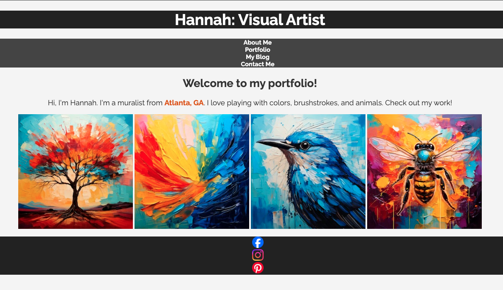
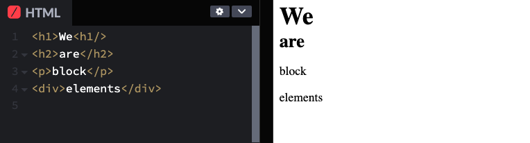
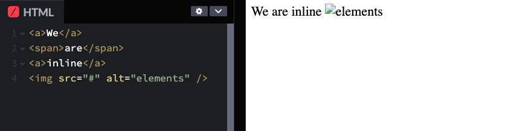
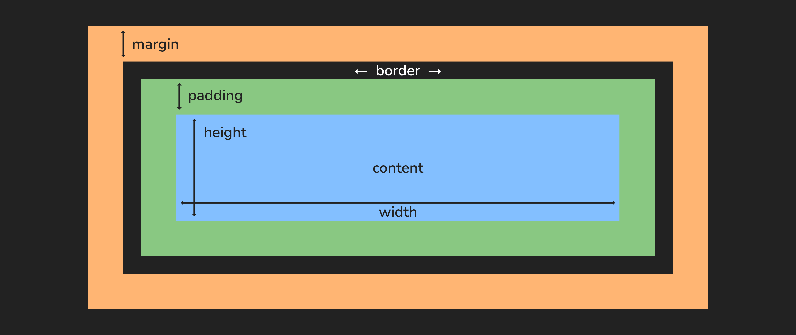
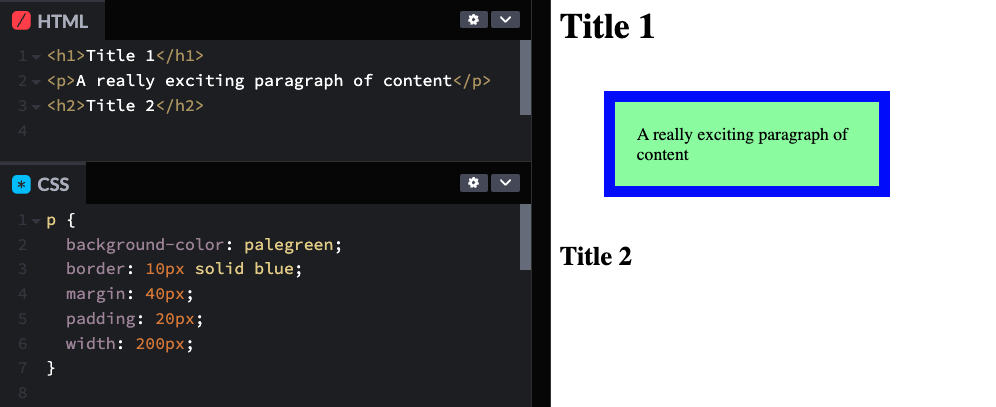
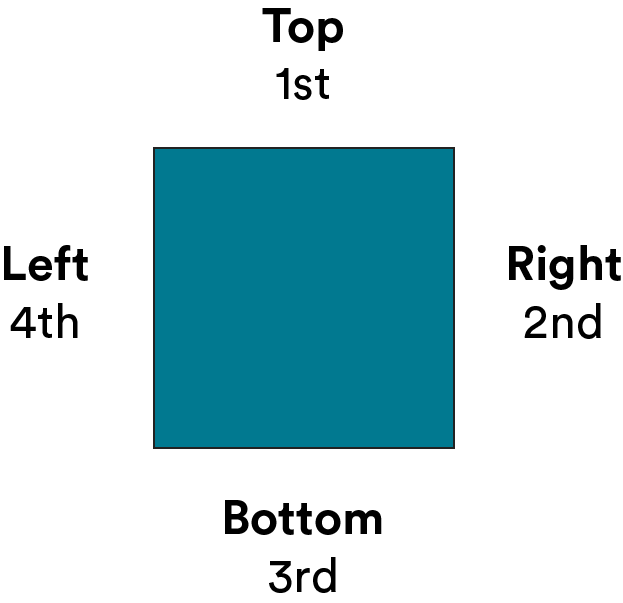
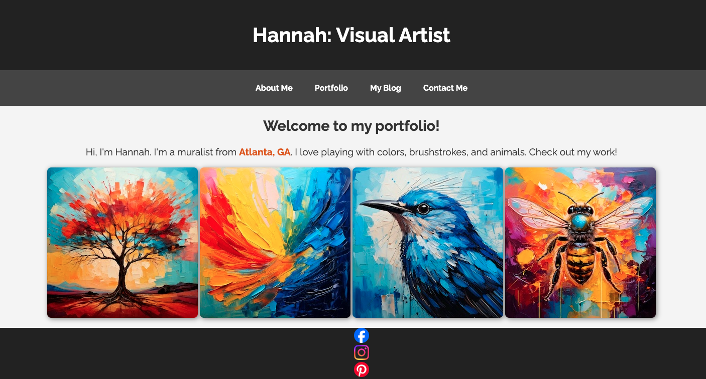

<textarea id="source">

<h1 class="slide-header">Adjusting Layout with CSS</h1>

<span id=time-estimate class="color-grey-500">30 mins</span>

<p id="lesson-description">
Have you ever visited a website and had no idea where to look? A cluttered, unorganized layout can make even the best content frustrating to navigate.

With CSS, you have the power to <strong>structure your website</strong> exactly how you want. You'll learn how to control spacing, alignment, and positioning to create a layout that looks great and guides users effortlessly.

By the end of this lesson, you’ll be designing pages that are <strong>clean, professional, and easy to navigate</strong>—no more confusing websites!

</p>

<h5 id="topics-header" class="color-grey-500">Topics</h5>

Inline and Block Elements

<hr>

The Box Model

<hr>

Positioning

<hr>

<a href="./assets/adjusting_layout_with_css_study_guide.pdf" target="_blank" download="adjusting_layout_with_css_study_guide.pdf" class="ant-btn" data-trackable="true" data-track-category="study guide" data-track-section="lesson page" data-track-action="download study guide"><span role="img" class="anticon"><svg viewBox="0 0 16 16" width="1em" height="1em" fill="currentColor" aria-hidden="true" focusable="false" class=""><g class="download_svg__nc-icon-wrapper"><path d="M8 12c.3 0 .5-.1.7-.3L14.4 6 13 4.6l-4 4V0H7v8.6l-4-4L1.6 6l5.7 5.7c.2.2.4.3.7.3z"></path><path data-color="color-2" d="M1 14h14v2H1z"></path></g></svg></span><span> Download Study Guide</span></a>

---

<h1 class="slide-header">Learning Objectives</h1>

<p>By the end of this lesson, you'll be able to:</p>

<ul>
  <li>Distinguish between inline and block HTML elements.</li>
  <li>Use the box model to adjust the size and spacing of HTML elements.</li>
  <li>Use CSS positioning to move HTML elements on a webpage.</li>
</ul>

---

<h1 class="slide-header">Connecting With Our Client</h1>

Hannah’s portfolio is coming to life with unique fonts and colors—but the layout still needs work.

Right now, her **navigation links are stacked** instead of sitting neatly in a row, and the **social media icons in the footer** have the same issue. Plus, everything feels a little cramped—there’s no spacing between elements!

In this lesson, we’ll learn how to **align navigation links, organize the social icons, and create better spacing** using **margin and padding**. We’ll also explore **positioning and display** techniques to control how elements are arranged, helping the site look polished, balanced, and easy to navigate!



---

<h1 class="slide-header">Understanding Display: Block vs. Inline</h1>

Every HTML element has **default styling**, like `<h1>` being larger than `<h2>` or `<ul>` having bullet points. But did you know that elements also have a **default way of displaying** on a webpage?

HTML elements are either **block elements** or **inline elements**.

| **Block Elements**                                     | **Inline Elements**                                   |
| ------------------------------------------------------ | ----------------------------------------------------- |
| Always start on a **new line**.                        | Stay **within the same line** as surrounding content. |
| Take up the **full width** of the container.           | Only take up as much width as needed.                 |
| Stack **vertically** when multiple are added.          | Appear **side by side** if space allows.              |
| Can have **margin, padding, width, and height**.       | Cannot have set margins, width, or height.            |
| Examples: `<h1>` - `<h6>`, `<div>`,<br> `<p>`, `<ul>`. | Examples: `<a>`, `<span>`, ``.                   |

These default behaviors affect how elements are arranged on a page. Want to see a visual? Click to the next slide!

---

<h1 class="slide-header">Block vs. Inline Elements</h1>

**Block Elements**

- Block elements **always start on a new line** and take up the full width available.
- As you add more block elements, they **stack on top of each other**, creating a vertical structure.



<br>

**Inline Elements**

- Inline elements **stay within the same line** as surrounding content.
- They only take up as much space as needed and **don’t force a new line**.



Anchor `<a>`, span `<span>`, and image `` elements all line up **side by side** instead of stacking by default.

---

<h1 class="slide-header">Changing the Display of Elements</h1>

Sometimes, an element’s default behavior doesn’t quite fit what we need.

- Ever added an `` and wished it took up its own line instead of sitting next to text? By default, images are **inline elements**, but we might want them to act like **block elements** instead.
- Ever added a `<ul>` and expected the list items to stack, but wanted them to sit side by side instead? By default, lists are **block elements**, but we can make them **inline** to display items in a row, like in a navigation bar.

Thankfully, CSS makes this easy! We can use the **`display` property** to change how elements behave on a webpage.

**Common `display` Values:**

- **`none`** – The element **disappears completely** (it won’t take up space on the page).
- **`inline`** – The element stays **in line** with surrounding content.
- **`block`** – The element stacks **on its own line** and takes up the **full width** available.
- **`inline-block`** – The element stays **inline** but behaves like a **block**, meaning it can have `margin`, `padding`, `width`, and `height`.

With the `display` property, you can **control how elements are arranged** and adjust them to fit your design!

---

<h1 class="slide-header">Knowledge Check</h1>

Let’s say you’ve added four images in HTML, like so:

```html


```

How could you use the CSS `display` property to stack these images on top of each other in a vertical column?

<fieldset>
  <legend>Please select one of the following</legend>
  <input type="radio" name="action" id="track" value="track" correct="true"/><label for="track">`display: block`</label><br />
  <input type="radio" name="action" id="event" value="event"  /><label for="event">`display: inline`</label><br />
  <input type="radio" name="action" id="message" value="message" /><label for="message">`display: none`</label><br />
  <input type="radio" name="action" id="answer4" value="answer4" /><label for="answer4">They'd display like that automatically</label><br />

</fieldset>
<button class="ant-btn ant-btn-primary multiple-choice-radio-submit">Submit Answer</button>

---

<h1 class="slide-header">Knowledge Check</h1>

Hannah would like us to create a **horizontal navigation bar** for her page, but right now the `<nav>` is displaying a vertical list. Sounds like a job for `display: inline-block`!

Which of the following elements should we target with this `display` property to fix the `<nav>`?

<fieldset>
  <legend>Please select one of the following</legend>
  <input type="radio" name="action" id="event" value="event"  /><label for="event">`nav`</label><br />
  <input type="radio" name="action" id="message" value="message" /><label for="message">The `ul` in the `nav`</label><br />
  <input type="radio" name="action" id="track" value="track" correct="true"/><label for="track">The `li`s in the `nav`</label><br />

</fieldset>
<button class="ant-btn ant-btn-primary multiple-choice-radio-submit">Submit Answer</button>

---

<h1 class="slide-header">Cleaning Up Our Nav</h1>

Right now, the navigation links are stacking **vertically**, one on top of the other. But we want them to sit **side by side** in a row.

To do this, we need to change how the **list items (`<li>`)** are displayed. By default, `<li>` elements are **block elements**, which means they stack on top of each other. We can fix this by changing the **`display` property** in CSS.

**1. In your HTML, find the `<li>` elements inside the navigation menu. Give each `<li>` a class called `nav-item`.**

**2. Create a CSS rule for `.nav-item`. Set `display: inline-block;` so the list items sit _side by side_ instead of stacking.**

<!-- adjusting-layout-with-css-hannahs-site-9 -->
<iframe   sandbox="allow-scripts allow-top-navigation allow-top-navigation-by-user-activation allow-forms allow-popups allow-same-origin"  height="400" style="width: 100%;" scrolling="no" title="Cleaning Up Our Nav" src="https://codepen.io/GAmarketing/embed/bNGRObx?default-tab=css%2Cresult&editable=true" frameborder="no" loading="lazy" allowtransparency="true" allowfullscreen="true">
  See the Pen <a href="https://codepen.io/GAmarketing/pen/bNGRObx">
  Cleaning Up Our Nav</a> by General Assembly (<a href="https://codepen.io/GAmarketing">@GAmarketing</a>)
  on <a href="https://codepen.io">CodePen</a>.
</iframe>

<small><strong>TIP:</strong> After updating your code, click the <strong>"Run"</strong> or <strong>"Rerun"</strong> button in CodePen to make sure your changes take effect. Then, check <strong>View Test Results</strong> to see if your updates pass!</small>

---

<h1 class="slide-header">Everything is a Box</h1>

Remember how we mentioned that **block** elements can have `margin`, `padding`, `width`, and `height` properties?

This idea is called the **CSS box model**, and it helps define **spacing, sizing, and layout**. Even though we don’t always see these boxes, they control how elements fit together on the page.

**What’s Inside the Box?**

1. **Content** – The actual text, image, or element inside the box (whatever you wrote in the HTML).
2. **Padding** – The space **between the content and the border**, pushing the edges of the box outward.
3. **Border** – The outer edge of the element (can be visible or invisible, depending on styles).
4. **Margin** – The space **outside the border**, pushing the element away from other elements.

Each of these properties affects **how big an element appears and how much space it takes up on the page**.



---

<h1 class="slide-header">The Box Model in Action</h1>

Take a look at the code snippet below and how it appears on the page.

- The **padding (20px)** creates space **inside the box**, pushing the text away from the blue border.
- The **margin (40px)** creates space **outside the box**, pushing it away from surrounding elements.

Both **margin** and **padding** are essential for organizing content and making a webpage easier to read.



---

<h1 class="slide-header">Knowledge Check</h1>

Imagine you want to create space **around** the `<nav>` element so that it doesn’t sit too close to the `<header>` and `<h2>`.

Which CSS property would you use to **push the `<nav>` away from the surrounding elements**?

<fieldset>
  <legend>Please select one of the following</legend>
  <input type="radio" name="action" id="track" value="track" correct="true"/><label for="track">margin</label><br />
  <input type="radio" name="action" id="event" value="event"  /><label for="event">padding</label><br />
</fieldset>

<button class="ant-btn ant-btn-primary multiple-choice-radio-submit">Submit Answer</button>

---

<h1 class="slide-header">Knowledge Check</h1>

Imagine you want to add more space **inside** each `<li>` in the `<nav>` (“About Me,” “Portfolio,” etc.) to make them easier to read and visually distinct.

Which CSS property would you use to **increase the space inside each list item**?

<fieldset>
  <legend>Please select one of the following</legend>
  <input type="radio" name="action" id="track" value="track" /><label for="track">margin</label><br />
  <input type="radio" name="action" id="event" value="event"  correct="true" /><label for="event">padding</label><br />
</fieldset>
<button class="ant-btn ant-btn-primary multiple-choice-radio-submit">Submit Answer</button>

---

<h1 class="slide-header">Applying Margin and Padding</h1>

So far, we’ve seen how to apply **equal** margins and padding to all sides of an element. But what if you only want to adjust **one side**—like adding extra space to the top or increasing the padding on the left?

You can _specify individual sides_ by listing values in a specific order:

```css
div {
  padding: 10px 0px 5px 15px;
}
```

The values follow this pattern:

- **Top** → `10px`
- **Right** → `0px`
- **Bottom** → `5px`
- **Left** → `15px`

This order always follows a **clockwise direction**: **Top → Right → Bottom → Left**.



---

<h1 class="slide-header">Shorthand Notation for Box-Model Properties</h1>

CSS allows us to use **shorthand notation** to apply spacing (like `margin` or `padding`) more efficiently. Instead of writing separate properties for each side, shorthand lets us define multiple values in a single line.

**One value** → Applies the same spacing to **all four sides**

```css
padding: 10px; /* 10px on top, right, bottom, and left */
```

**Two values** → First value applies to **top & bottom**, second applies to **left & right**

```css
padding: 10px 20px; /* 10px on top & bottom, 20px on left & right */
```

Shorthand notation makes your CSS **cleaner, easier to read, and faster to write**!

---

<h1 class="slide-header">Adjusting our Content Spacing</h1>

Now that we know how to use **margin and padding**, let’s apply them to improve the spacing in our layout. This will help create a more balanced and visually appealing design.

**1. Find the `<header>` element in your CSS. Set `padding` to `20px 0;` to add vertical space to the top and bottom of the header, but no extra space on the sides.**

**2. Find the `<nav>` element in your CSS. Set `padding` to `10px 0;` to add vertical space on the top and bottom of the navigation bar, but no extra space on the sides.**

**3. Find the `.nav-item` class in your CSS. Set `margin` to `0 20px;` so each item has `20px` of space on each side but no extra space on the top or bottom.**

By default, web browsers add _extra margin_ around the `<body>` element, which prevents content from reaching the very edges of the page. Removing this margin helps create a cleaner, more polished look.

**4. In your CSS, find the rule for `body`. Add `margin: 0;` to remove the default spacing on _all sides_.**

Once you've added these styles, check the webpage and see how much better everything looks with proper spacing!

<!-- adjusting-layout-with-css-hannahs-site-10 -->
<iframe   sandbox="allow-scripts allow-top-navigation allow-top-navigation-by-user-activation allow-forms allow-popups allow-same-origin"  height="400" style="width: 100%;" scrolling="no" title="Adjusting our Content Spacing" src="https://codepen.io/GAmarketing/embed/KwKqbNj?default-tab=css%2Cresult&editable=true" frameborder="no" loading="lazy" allowtransparency="true" allowfullscreen="true">
  See the Pen <a href="https://codepen.io/GAmarketing/pen/KwKqbNj">
  Adjusting Width and Height</a> by General Assembly (<a href="https://codepen.io/GAmarketing">@GAmarketing</a>)
  on <a href="https://codepen.io">CodePen</a>.
</iframe>

<small><strong>TIP:</strong> After updating your code, click the <strong>"Run"</strong> or <strong>"Rerun"</strong> button in CodePen to make sure your changes take effect. Then, check <strong>View Test Results</strong> to see if your updates pass!</small>

---

<h1 class="slide-header">The Position Property</h1>

The `position` property controls **where elements appear on the page**. Do you want something to shift slightly from its normal spot? Or do you need it to be placed in a _specific_ location? The `position` property helps with that!

Here are the most commonly used values:

- **`relative`** – Moves an element **relative to where it normally appears**, without affecting other content.
- **`absolute`** – Moves an element **relative to its nearest positioned parent**, or to the entire page if no positioned parent exists.
- **`fixed`** – Keeps an element **locked in place**, even when scrolling (think about a navigation bar that stays fixed at the top of the page).

These positioning options give you more control over your layout by making possible to control the position of specific elements.

---

<h1 class="slide-header">Positioning Elements</h1>

Now that we’ve set _how_ an element is positioned, let’s control _where_ it appears on the page.

We can do this using the **`top`**, **`right`**, **`bottom`**, and **`left`** properties. These values define the **distance from a reference point**, measured in pixels `px` or other units.

For these properties to work, the element **must have a `position` value** (`relative`, `absolute`, or `fixed`). Without it, the `top`, `left`, `right`, and `bottom` properties **won’t do anything**!

Let's take a look at an example...

---

<h1 class="slide-header">Position: Relative</h1>

When you set an element to **`position: relative`**, it moves **relative to its original position** on the page—without affecting other elements around it.

We’ll start with **two stacked `<div>`'s**—one yellow and one blue. By default, as block elements, they sit on top of each other in the top-left corner of the page.

Now, let’s apply **relative positioning** to the **yellow** `<div>`:

```css
#yellow {
  /* Other styles above */
  position: relative;
  left: 0px;
  top: 0px;
}
```

**What Happens?**

- If you said **_nothing_**, you are correct! We told the box to move `0px` from the left and `0px` from the top of where it was relatively positioned. In other words...where it started. Therefore, it didn't move.

**Now try the following:**

- `left: 100px;` → Moves the yellow box **100 pixels away from the left edge** of its original position
- `top: 20px;` → Moves the yellow box **20 away from the top** of its original position.
- The **blue box does not move**—only the yellow box is affected!

Try experimenting with **negative values** (`left: -50px;`) to see how the movement changes!

<!-- position-properties-in-action -->
<iframe   sandbox="allow-scripts allow-top-navigation allow-top-navigation-by-user-activation allow-forms allow-popups allow-same-origin"  height="400" style="width: 100%;" scrolling="no" title="Position Properties in Action" src="https://codepen.io/GAmarketing/embed/LEYjwmW?default-tab=css%2Cresult&editable=true" frameborder="no" loading="lazy" allowtransparency="true" allowfullscreen="true">
  See the Pen <a href="https://codepen.io/GAmarketing/pen/LEYjwmW">
  Adjusting Width and Height</a> by General Assembly (<a href="https://codepen.io/GAmarketing">@GAmarketing</a>)
  on <a href="https://codepen.io">CodePen</a>.
</iframe>

<small><strong>TIP:</strong> After updating your code, click the <strong>"Run"</strong> or <strong>"Rerun"</strong> button in CodePen to make sure your changes take effect. Then, check <strong>View Test Results</strong> to see if your updates pass!</small>

---

<h1 class="slide-header">Position: Absolute</h1>

When an element has **`position: absolute`**, it moves **relative to its nearest positioned parent** (a parent element with `relative`, `absolute`, or `fixed` positioning).

**If no parent has a set position**, the element is positioned **relative to the entire page `<body>`**.

Let’s apply **absolute positioning** to the **blue** `<div>`:

```css
#blue {
  /* Other styles above */
  position: absolute;
  left: 0px;
  top: 0px;
}
```

**What Happens?**

- The **blue box jumps to the very top-left corner** of the page (`left: 0px;`, `top: 0px;`).
- Since **absolute positioning removes it from the normal flow**, the blue box now **overlaps the yellow box** instead of stacking below it.

**Now try the following:**

- Change `left: 100px;` → Moves it **100px to the right**.
- Change `top: 50px;` → Moves it **50px down**.

- Change `top: 20px;` → `bottom: 20px;` Now, instead of moving down from the top, the box moves **up from the bottom**.

Try experimenting with **negative values** `left: -20px;` to see how the movement changes!

<!-- position-properties-in-action -->
<iframe   sandbox="allow-scripts allow-top-navigation allow-top-navigation-by-user-activation allow-forms allow-popups allow-same-origin"  height="400" style="width: 100%;" scrolling="no" title="Position Properties in Action" src="https://codepen.io/GAmarketing/embed/LEYjwmW?default-tab=css%2Cresult&editable=true" frameborder="no" loading="lazy" allowtransparency="true" allowfullscreen="true">
  See the Pen <a href="https://codepen.io/GAmarketing/pen/LEYjwmW">
  Adjusting Width and Height</a> by General Assembly (<a href="https://codepen.io/GAmarketing">@GAmarketing</a>)
  on <a href="https://codepen.io">CodePen</a>.
</iframe>

<small><strong>TIP:</strong> After updating your code, click the <strong>"Run"</strong> or <strong>"Rerun"</strong> button in CodePen to make sure your changes take effect. Then, check <strong>View Test Results</strong> to see if your updates pass!</small>

---

<h1 class="slide-header">Position: Fixed</h1>

When an element has **`position: fixed`**, it **stays in place on the screen**, no matter how much you scroll.

Unlike `relative` or `absolute`, a **fixed element is not affected by other elements and does not move with the page**—it remains stuck to a set position relative to the **viewport** (the visible screen area).

Let's’ll apply **fixed positioning** to the **blue** `<div>`:

```css
#blue {
  /* Other styles above */
  position: fixed;
  left: 0px;
  top: 0px;
}
```

Now let's increase the hight of the body so we have room to scroll. Try it!

```css
body {
  height: 1000px;
}
```

**What Happens?**

- The **blue box is locked in the top-left corner** of the screen (`left: 0px;`, `top: 0px;`).
- **Even when you scroll**, the blue box **stays in place** instead of moving with the page.
- The yellow box will **scroll normally**, but the blue box does not- it is _fixed_.

<!-- position-properties-in-action -->
<iframe   sandbox="allow-scripts allow-top-navigation allow-top-navigation-by-user-activation allow-forms allow-popups allow-same-origin"  height="400" style="width: 100%;" scrolling="no" title="Position Properties in Action" src="https://codepen.io/GAmarketing/embed/LEYjwmW?default-tab=css%2Cresult&editable=true" frameborder="no" loading="lazy" allowtransparency="true" allowfullscreen="true">
  See the Pen <a href="https://codepen.io/GAmarketing/pen/LEYjwmW">
  Adjusting Width and Height</a> by General Assembly (<a href="https://codepen.io/GAmarketing">@GAmarketing</a>)
  on <a href="https://codepen.io">CodePen</a>.
</iframe>

<small><strong>TIP:</strong> After updating your code, click the <strong>"Run"</strong> or <strong>"Rerun"</strong> button in CodePen to make sure your changes take effect. Then, check <strong>View Test Results</strong> to see if your updates pass!</small>

---

<h1 class="slide-header">Knowledge Check</h1>

Which `position` value moves an element relative to where it originally appears on the page, without affecting other elements?

<fieldset>
  <legend>Please select one of the following</legend>
  <input type="radio" name="action" id="track" value="track" correct="true"/><label for="track">relative</label><br />
  <input type="radio" name="action" id="event" value="event"/><label for="event">absolute</label><br />
</fieldset>
<button class="ant-btn ant-btn-primary multiple-choice-radio-submit">Submit Answer</button>

---

<h1 class="slide-header">Knowledge Check</h1>

Which `position` value keeps an element locked in place on the screen, even when the page is scrolled?

<fieldset>
  <legend>Please select one of the following</legend>
  <input type="radio" name="action" id="event" value="event"/><label for="event">absolute</label><br />
  <input type="radio" name="action" id="track" value="track" correct="true"/><label for="track">fixed</label><br />
</fieldset>
<button class="ant-btn ant-btn-primary multiple-choice-radio-submit">Submit Answer</button>

---

<h1 class="slide-header">Knowledge Check</h1>

Which `position` value removes an element from the normal document flow and positions it relative to its closest positioned parent (or the entire page if no parent is positioned)?

<fieldset>
  <legend>Please select one of the following</legend>
  <input type="radio" name="action" id="event" value="event"/><label for="event">fixed</label><br />
  <input type="radio" name="action" id="track" value="track" correct="true"/><label for="track">absolute</label><br />
</fieldset>
<button class="ant-btn ant-btn-primary multiple-choice-radio-submit">Submit Answer</button>

---

<h1 class="slide-header">Adjusting the Image Gallery</h1>

Now, let’s shift our focus to the **most important part of the page—Hannah’s artwork!** The image gallery looks great, but with a few refinements, we can make it **stand out** and look more polished.

**1. In your HTML, find the `<div>` that holds all the artwork images. Add an `id="image-container"` to this `<div>`.**

**2. Using the CSS selector: `#image-container img` create a rule that targets each image inside `#image-container`.**

**3. Apply these styling properties:**

- **Rounded corners: Add `border-radius: 8px;` to make the image edges slightly curved.**
- **Subtle shadow effect: Add `box-shadow: 2px 2px 10px rgba(0, 0, 0, 0.5);` to create a soft, 3D effect that makes the images pop off the page.**

Once you apply these changes, Hannah’s artwork will look even more professional and visually appealing!

<!-- adjusting-layout-with-css-hannahs-site-11 -->
<iframe   sandbox="allow-scripts allow-top-navigation allow-top-navigation-by-user-activation allow-forms allow-popups allow-same-origin"  height="400" style="width: 100%;" scrolling="no" title="Adjusting our Content Spacing" src="https://codepen.io/GAmarketing/embed/ZYEXzZX?default-tab=css%2Cresult&editable=true" frameborder="no" loading="lazy" allowtransparency="true" allowfullscreen="true">
  See the Pen <a href="https://codepen.io/GAmarketing/pen/ZYEXzZX">
  Adjusting Width and Height</a> by General Assembly (<a href="https://codepen.io/GAmarketing">@GAmarketing</a>)
  on <a href="https://codepen.io">CodePen</a>.
</iframe>

<small><strong>TIP:</strong> After updating your code, click the <strong>"Run"</strong> or <strong>"Rerun"</strong> button in CodePen to make sure your changes take effect. Then, check <strong>View Test Results</strong> to see if your updates pass!</small>

---

<h1 class="slide-header">Conclusion</h1>

Hannah’s site is looking great! But wait… we didn’t actually use any of our new positioning techniques?



<br>

That’s because in **modern web development**, we focus on making pages **responsive**—meaning they look good on **all screen sizes**, from desktops to mobile devices. While `position` is useful in some cases, it’s not the best tool for **structuring entire layouts**.

There’s a **better way** to control the placement of multiple elements: **Flexbox!**

In our next lesson, we’ll explore **Flexbox**, a powerful tool that makes **aligning, spacing, and organizing layouts easier and more flexible**.

For more information or resources on CSS display and position properties, check out:

- <a href="http://learnlayout.com/display.html" target="_blank" rel="noreferrer noopener">Learn Layout: The `display` Property</a>
- <a href="http://learnlayout.com/position.html" target="_blank" rel="noreferrer noopener">Learn Layout: Position</a>

</textarea>
